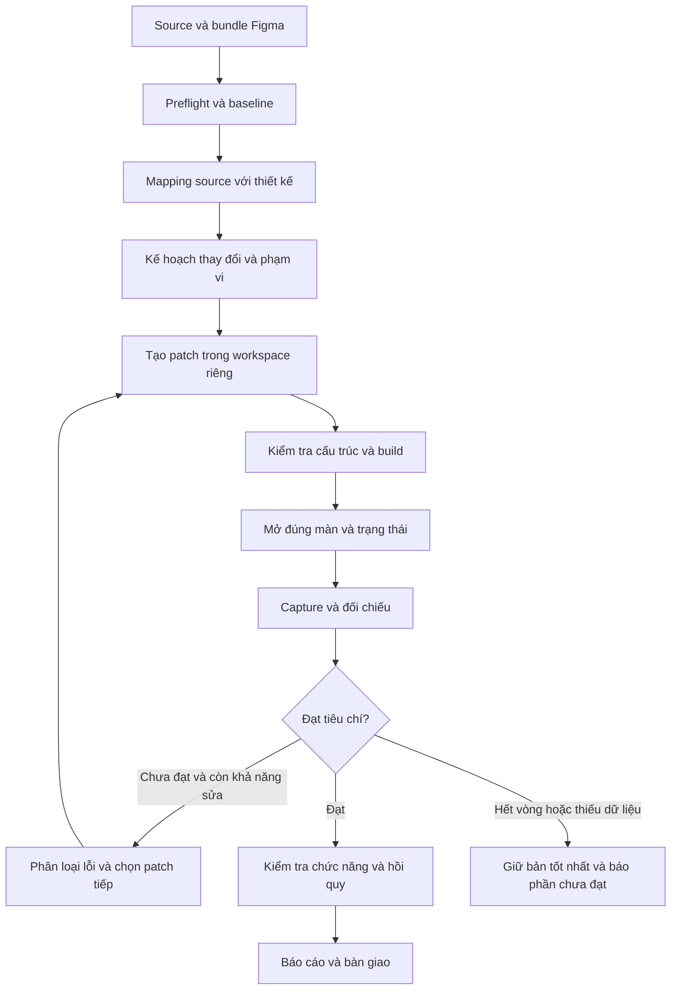

# Kế hoạch triển khai workflow reskin Android XML

Ngày lập: 2026-10-21  
Dự án: LazyReskin  
Trạng thái: kế hoạch thiết kế và triển khai; chưa phải mô tả tính năng engine đã có.

> Engine nền tảng và MVP `colors-icons` đã được triển khai một phần theo kế hoạch này. Xem [reskin-engine.md](reskin-engine.md) để biết commands, khả năng thực tế và các phần chưa có; không suy ra toàn bộ các mốc bên dưới đã hoàn thành.

## 1. Mục tiêu và quyết định chính

Xây dựng workflow dùng lại được để reskin ứng dụng Android có source sẵn, dựa trên bundle JSON, screenshots và assets xuất từ Figma.

Workflow cần:

1. Đọc source đang hoạt động và xác định đúng thành phần cần sửa.
2. Ưu tiên các job phổ biến: thay màu, icon, background và nhận diện thương hiệu.
3. Cho phép mở rộng sang typography, spacing hoặc bố cục khi job khai báo phạm vi tương ứng.
4. Build, render và so sánh với Figma; lặp sửa có giới hạn và có bằng chứng cải thiện.
5. Bảo toàn chức năng hiện có và phát hiện ảnh hưởng lên màn hình dùng chung resources.
6. Lưu mapping, cấu hình, checkpoint và báo cáo để tiếp tục hoặc chạy lại.

**Quyết định kiến trúc:** Skill hướng dẫn agent + CLI/scripts điều phối + project profile + skin package. Giao diện điều khiển trực quan là giai đoạn sau.

**Quyết định công nghệ:** giao diện đích là Android Views/XML. Không đưa việc tạo app mới vào workflow này.

## 2. Phạm vi và giới hạn

### 2.1. Trong phạm vi

- Layout XML của Activity, Fragment, item list, include, dialog, popup và bottom sheet.
- Colors, themes, styles, dimensions, selectors, drawable, font và mipmap phục vụ diện mạo.
- Đọc Kotlin/Java để tìm nơi inflate layout, dùng binding và ghi đè thuộc tính giao diện.
- Thay đổi phần trình bày trong Kotlin/Java chỉ khi job cho phép và đã xác định ảnh hưởng.
- Kiểm tra runtime, các trạng thái UI và những màn chịu ảnh hưởng của resource dùng chung.

### 2.2. Ngoài phạm vi mặc định

- Tạo app mới, màn hình nghiệp vụ mới hoặc luồng điều hướng mới.
- Viết lại kiến trúc, ViewModel, repository, API, database, DI hoặc logic nghiệp vụ.
- Chuyển framework UI, nâng SDK/dependencies hoặc thay hệ thống build.
- Đổi package/application ID, cấu hình dịch vụ, signing hoặc phát hành app.
- Sửa nội dung hoặc hành vi bên trong SDK bên thứ ba không thuộc source kiểm soát được.

Các yêu cầu ngoài phạm vi được lập thành task riêng; không tự động đưa vào một job reskin.

### 2.3. Cách hiểu “chỉ XML”

UI được triển khai bằng XML và hệ thống Android Views. Engine vẫn phải đọc code runtime vì màu, tint, kích thước, visibility hoặc background có thể được đặt lại bằng Kotlin/Java.

Mặc định chỉ sửa resources/XML. Nếu một runtime override ngăn thiết kế có hiệu lực, báo đúng vị trí và đề xuất thay đổi phần trình bày. Chỉ sửa khi phạm vi job đã cho phép; không mở rộng sang nghiệp vụ.

## 3. Ba mức reskin

| Mức | Phần được thay đổi | Chính sách mặc định |
| --- | --- | --- |
| `colors-icons` | Màu, tint, icon, hình nền và asset thương hiệu được chỉ định | Mức mặc định; ưu tiên sửa resource/style/theme |
| `appearance` | Toàn bộ mức trên, cộng font, typography, radius, border, elevation, spacing và kích thước | Cho phép đổi thuộc tính hiển thị, giữ cấu trúc view nếu có thể |
| `layout` | Toàn bộ mức trên, cộng vị trí và cấu trúc nhóm view | Cần kiểm tra kỹ binding, parent-child assumptions, scroll và tương tác |

Một job khai báo cả thuộc tính được phép đổi và phạm vi màn hình. Với `colors-icons`, khác biệt bố cục so với Figma phải được báo là ngoài phạm vi, không bị coi là lỗi cần tự sửa.

Nếu mục tiêu là khớp toàn màn hình nhưng Figma khác cấu trúc source, job cần mức `layout`. Không thể cam kết khớp toàn bộ bằng cách chỉ thay màu/icon.

## 4. Trạng thái đầu vào hiện tại

Plugin Figma trong dự án cung cấp bundle gồm JSON từng màn, screenshots tham chiếu và assets/manifest. README hiện tại mô tả cơ chế đối soát thư viện và lựa chọn screenshot theo frame.

Đây là đầu vào của workflow reskin, chưa phải bằng chứng bundle nào cũng đủ hoặc chính xác. Mỗi job phải kiểm tra bundle thực tế, phiên bản schema, mapping screenshot và trạng thái export asset.

Tài liệu [auto-reskin-workflow.md](auto-reskin-workflow.md) là khảo sát ban đầu của source tham khảo. Những lỗi plugin trong tài liệu đó phản ánh thời điểm khảo sát, không mặc nhiên mô tả phiên bản hiện tại.

## 5. Hợp đồng đầu vào của một job

| Đầu vào | Vai trò | Cần kiểm tra |
| --- | --- | --- |
| Source Android | Nguồn cấu trúc, chức năng và resources hiện tại | Source revision/snapshot, module, biến thể build, trạng thái build ban đầu |
| JSON Figma | Giá trị hình học, typography, paint, hierarchy và trạng thái thiết kế | Đọc được schema; root/node IDs nhất quán; dữ liệu thiếu được nhận diện |
| Screenshot Figma | Hình tham chiếu để so sánh render | Liên kết đúng frame/state, kích thước, vùng content và export scale |
| Assets và manifest | Hình/icon cần dùng | File tồn tại, status, định dạng, scale, tên trùng và instance overrides |
| Fonts | Typeface và weight đúng thiết kế | File hợp lệ, family/weight có thể map sang Android |
| Project profile | Cách build, mở màn, tái tạo trạng thái và giới hạn sửa | Khớp source hiện tại và môi trường chạy |
| Phạm vi job | Các màn và thuộc tính cần reskin | Xác định rõ mức reskin và vùng giữ nguyên |

Nếu thiếu font hoặc asset bắt buộc, engine báo thiếu và xác định các node bị ảnh hưởng. Không tự thay bằng hình khác hoặc ẩn thành phần để đạt điểm so ảnh.

Nếu chưa có screenshot tham chiếu cho một state, vẫn có thể kiểm tra resource/mapping nhưng không báo state đó đã đạt đối chiếu hình ảnh.

## 6. Vai trò của từng lớp

| Lớp | Trách nhiệm |
| --- | --- |
| Plugin Figma | Xuất thiết kế, screenshots và assets với định danh truy vết |
| Bundle adapter | Đọc phiên bản bundle, kiểm tra file và chuẩn hóa dữ liệu |
| Source analyzer | Lập chỉ mục layouts, resources, nơi sử dụng và runtime overrides |
| Mapping layer | Liên kết Figma screen/node/state với XML/view/resource/source |
| Agent | Xử lý quyết định ngữ nghĩa, đề xuất patch và sửa lỗi có phạm vi |
| Patch engine | Kiểm tra thay đổi được phép, source fingerprint và tính áp dụng lại |
| Capture runner | Build, mở đúng màn/state và lấy screenshot/runtime evidence |
| Visual evaluator | So sánh dữ liệu và ảnh, xuất lỗi theo vùng |
| Orchestrator | Điều phối vòng lặp, checkpoint, giới hạn vòng và chọn kết quả tốt nhất |
| Reporter | Tổng hợp trước/sau, khác biệt, ảnh hưởng, kiểm chứng và phần còn thiếu |

Agent không tự tuyên bố hoàn thành chỉ bằng nhận xét hình ảnh. Trạng thái hoàn thành do bộ điều phối xác định từ kết quả kiểm tra và phạm vi job.

## 7. Pipeline tổng thể



### 7.1. Preflight và baseline

- Xác định module app, build variant/flavor, package và công cụ build sẵn có.
- Đọc source state; tạo worktree nếu phù hợp hoặc snapshot riêng nếu source không có Git.
- Giữ nguyên chỉnh sửa chưa commit của người dùng; không dùng reset/stash tự động để làm sạch source.
- Xác minh build ban đầu và đường vào màn hình cần reskin.
- Ghi screenshot baseline của app cũ và hành vi chính trước khi sửa.
- Kiểm tra JSON, screenshots, assets và fonts của đúng các màn được chọn.

Đầu ra: báo cáo đầu vào, source fingerprint, baseline build/capture và danh sách vấn đề có trước.

Lỗi build tồn tại trước phải được phân biệt với lỗi do patch. Không tự sửa toàn bộ dự án để vượt preflight.

### 7.2. Phân tích source

Lập chỉ mục:

- Layout chính, include/merge/ViewStub, item layout và layout dùng lại.
- Activity/Fragment/Adapter/ViewHolder/Dialog sử dụng các layout đó.
- View ID, kiểu view, ViewBinding/DataBinding/findViewById và binding expressions.
- Color/style/theme/attribute/dimension/font/selector/drawable/mipmap liên quan.
- Resource qualifiers, flavor/source set và thứ tự ảnh hưởng tới build variant được chọn.
- Runtime setters: tint, màu, background, typeface, padding, size, visibility và nội dung ảnh.
- Custom Views, Canvas, MotionLayout và nội dung WebView/SDK cần xử lý riêng.

Parser XML cần dựa trên cấu trúc XML; tìm kiếm văn bản chỉ hỗ trợ tìm nơi sử dụng, không thay cho phân tích XML.

Đầu ra: source index và đồ thị nơi sử dụng resources. Kết quả phân tích tĩnh chưa xác định được phải được đánh dấu để đối chiếu runtime.

### 7.3. Mapping

Mapping theo màn trước, sau đó theo vùng và view/resource. Dùng vai trò, nội dung, hierarchy, component và geometry; tên node chỉ là một tín hiệu.

Ví dụ:

```text
Figma: Home / Header / Settings
  -> activity_home.xml
  -> @id/btnSettings
  -> @drawable/ic_settings
  -> HomeActivity: nơi sử dụng và xử lý tương tác
```

Mapping phải hỗ trợ:

- Một node tương ứng nhiều view, hoặc nhiều node tương ứng một drawable.
- Nhánh graphic đã gộp thành asset mà không mất nghĩa là đã xử lý các node con.
- Một template item tương ứng nhiều phần tử RecyclerView.
- Cùng một màn có nhiều state; cùng một resource có nhiều consumer.
- Instance có override khác nhau dù chung main component.

Mỗi mapping lưu: nguồn Figma/node ID, screen/state, layout/view/resource đích, lý do ghép, mức chắc chắn và trạng thái xác nhận.

Nếu node ID thay đổi do duplicate/recreate Figma, đề xuất remap bằng cấu trúc/vai trò và báo độ chắc chắn. Không áp dụng mapping cũ chỉ vì tên gần giống.

### 7.4. Lập kế hoạch và dry-run

Trước khi sửa, xuất change plan gồm:

- Màn/state và thuộc tính sẽ thay đổi.
- File/resource/view bị tác động.
- Resource dùng chung và danh sách màn cần kiểm tra hồi quy.
- Chỗ cần sửa runtime presentation nếu có.
- Mapping chưa chắc chắn, dữ liệu thiếu và khác biệt vượt phạm vi.

Dry-run dừng ở kế hoạch này, không sửa app. Job đã đủ phạm vi và mapping có thể tiếp tục tự động; không yêu cầu xác nhận lại cho từng thay đổi nhỏ đã được cho phép.

### 7.5. Sinh patch

- Ưu tiên thay resources/theme/style; chỉ sửa layout khi thuộc tính cần thiết nằm ở layout.
- Giữ tên layout, view ID, kiểu view và binding tương thích khi có thể.
- Không áp quy tắc đặt tên của app mẫu để đổi tên hàng loạt source cũ.
- Kiểm tra ảnh hưởng của việc đổi parent, view type, root hoặc include lên code hiện có.
- Chỉ đổi shared resource toàn cục nếu job khai báo thay đổi toàn cục; nếu chỉ một màn cần khác thì tạo resource riêng có chủ đích.
- Chuyển SVG theo tập tính năng hỗ trợ. Transform, mask, clip, gradient hoặc filters không hỗ trợ phải được báo; fallback raster cần được khai báo và kiểm tra chất lượng.
- Lưu fingerprint đầu vào và file đích; phát hiện file bị sửa sau khi lập kế hoạch trước khi áp patch.
- Chạy lại cùng source đích, cùng skin và cấu hình phải cho kết quả ổn định; khi đã đạt trạng thái đích thì không tạo diff mới.

### 7.6. Kiểm tra và capture

- Kiểm tra XML parse được, resource references, ViewBinding/DataBinding và giới hạn phạm vi sửa.
- Build đúng variant đã chọn.
- Chạy app, mở màn bằng navigation/deep link/test hook đã cấu hình.
- Chờ điều kiện sẵn sàng có thể quan sát, thay vì chỉ sleep một khoảng cố định.
- Ưu tiên điều hướng bằng resource ID hoặc ngữ nghĩa view; tọa độ chỉ là fallback được ghi nhận.
- Chụp ảnh và lưu trạng thái môi trường, log lỗi liên quan cùng UI evidence nếu có.

### 7.7. Nghiệm thu và bàn giao

Kiểm tra từng tiêu chí ở mục 12. Báo cáo phải thể hiện đầy đủ phần đạt, ngoài phạm vi, thiếu dữ liệu và chưa kiểm chứng.

Không tự merge/publish/phát hành chỉ vì vòng kiểm tra giao diện đã đạt.

## 8. Render và chuẩn hóa môi trường

### 8.1. Chọn công cụ

| Công cụ | Vai trò | Thời điểm bổ sung |
| --- | --- | --- |
| Emulator + điều hướng tự động + screenshot | Kiểm chứng trên app thực, gồm code runtime và tương tác | MVP |
| Paparazzi | Render nhanh XML/View/component có thể dựng độc lập | Sau khi xác minh tương thích dự án và có nhu cầu tăng tốc |
| Roborazzi | Lựa chọn JVM/Robolectric cho View/Activity và screenshot tests | Ưu tiên xem xét nếu app đã có Robolectric |
| Layout Inspector hoặc runtime hierarchy phù hợp | Chẩn đoán thuộc tính thực tế và vị trí khác với XML dự kiến | Theo khả năng môi trường, không giả định là API tự động có sẵn |

Không cài đồng thời mọi framework ngay từ đầu. Chọn công cụ sau khi thử trên dự án pilot; không nâng AGP/SDK chỉ để phù hợp một renderer.

### 8.2. Điều kiện capture cố định

- Kích thước viewport, density, font scale và API level.
- Ngôn ngữ, hướng chữ, theme/day-night.
- System bars, cutout, edge-to-edge và vùng nội dung đem so.
- Dữ liệu, scroll position, selection, permissions, keyboard và trạng thái đăng nhập.
- Thời điểm animation, loading và ảnh mạng đã sẵn sàng.

Screenshot Figma có đơn vị export riêng; phải map rõ về kích thước logic Android và scale. Không resize méo hoặc tự căn lại từng vùng ảnh để che sai lệch layout.

### 8.3. Dữ liệu động

Dùng fixtures/debug hooks khi cần tái tạo state và job cho phép. Tách khỏi luồng production; không sửa API/repository production để hiển thị giống ảnh tham chiếu.

Các vùng động như giờ hệ thống, quảng cáo hoặc avatar mạng chỉ được mask khi có cấu hình vùng cụ thể và lý do. Báo diện tích bị loại trừ; không mask phần UI đang lỗi. Nếu có thể, ưu tiên cố định dữ liệu hơn mask.

## 9. So sánh giao diện và vòng lặp sửa

### 9.1. Ba lớp đánh giá

| Lớp | Kiểm tra | Giới hạn |
| --- | --- | --- |
| Cấu trúc và thuộc tính | Mapping coverage, asset, màu, font, size, hierarchy và trạng thái | Giá trị khai báo có thể bị runtime ghi đè |
| Hình ảnh | Geometry, text wrapping, crop, tint, background, border, radius, shadow | Khác renderer có thể tạo nhiễu ở chữ và anti-aliasing |
| Runtime và hành vi | State thực tế, click, scroll, navigation, visibility và code overrides | Cần kịch bản tái tạo và môi trường sẵn sàng |

Kết hợp khác biệt pixel, overlay/heatmap, sai khác theo vùng và metric cảm nhận như SSIM khi phù hợp. Metric tổng không đủ để kết luận icon nhỏ hoặc nút quan trọng đã đúng.

Không chốt một con số “giống 99%” áp dụng cho mọi app. Ngưỡng phải được hiệu chỉnh bằng mẫu đạt/chưa đạt, vùng quan trọng và nhiễu của renderer.

### 9.2. Phân loại issue

Mỗi issue có screen/state, Figma node, view/resource nghi ngờ, bằng chứng, mức độ, thuộc tính và phạm vi sửa.

Nhóm lỗi:

- Thiếu/sai asset hoặc export/conversion không đủ tính năng.
- Sai màu/tint hoặc màu bị runtime override.
- Sai font/weight/line height, xuống dòng, baseline, includeFontPadding hoặc ellipsis.
- Sai bounds, constraints, margins, padding, icon viewport hoặc scaleType.
- Sai corner, stroke, gradient, shadow hoặc clipping.
- Sai state, visibility, system insets hoặc dữ liệu mẫu.
- Khác biệt ngoài phạm vi job hoặc chưa đủ bằng chứng để kết luận.

### 9.3. Quy trình mỗi vòng

1. Lấy candidate từ checkpoint đang tốt nhất và đọc issues còn mở.
2. Chọn nhóm lỗi có nguyên nhân liên quan; tạo patch nhỏ trong phạm vi.
3. Kiểm tra cấu trúc và build. Candidate không build được không được coi là cải thiện hình ảnh.
4. Capture đúng màn/state, cùng môi trường.
5. So sánh theo vùng và tiêu chí của mức reskin.
6. Kiểm tra vùng đã đúng có bị hồi quy không.
7. Giữ candidate nếu đạt điều kiện cải thiện; nếu không thì loại patch của vòng đó trong workspace riêng.
8. Lưu issues và checkpoint tiếp theo.

Với mức `layout`, xử lý geometry lớn và font trước khi tinh chỉnh chi tiết. Với `colors-icons`, chỉ xử lý các thuộc tính thuộc phạm vi, tránh kéo vòng lặp sang chỉnh bố cục.

### 9.4. Điều kiện dừng đề xuất

- Dừng thành công khi đủ điều kiện nghiệm thu của job.
- Mặc định tối đa 6 vòng/màn; cấu hình được theo job.
- Dừng chẩn đoán khi 2 vòng liên tiếp không cải thiện hoặc lặp lại cùng lỗi.
- Dừng phần công việc phụ thuộc khi thiếu asset/font/state, mapping không xác định được hoặc source conflict.
- Không dùng việc hết vòng làm bằng chứng thành công; giữ bản tốt nhất và báo phần chưa đạt.

Ngưỡng 6 vòng/2 vòng không cải thiện là chính sách khởi đầu cần hiệu chỉnh sau pilot, không phải cam kết chất lượng.

## 10. Bảo toàn chức năng và kiểm tra hồi quy

Baseline và kiểm chứng sau patch tập trung vào các vùng bị ảnh hưởng:

- Binding, listeners, navigation và các view code tham chiếu.
- Click, long-press, selected/disabled state, focus và scroll.
- Adapter/ViewHolder, item types và việc tái sử dụng view.
- Dialog/bottom sheet mở, đóng và trả kết quả như trước.
- Runtime styling không đảo ngược thay đổi thiết kế sau khi resume hoặc đổi state.
- Các màn có consumer chung của resource bị sửa.

Một build thành công không chứng minh hành vi được bảo toàn. Nếu chưa chạy được runtime/smoke checks, report phải ghi chưa kiểm chứng, không báo job hoàn tất toàn bộ.

Sau khi khớp viewport Figma chuẩn, kiểm tra thêm viewport hẹp/rộng và các cấu hình trong profile để tránh khớp ảnh nhưng hỏng responsive.

## 11. Cấu hình và dữ liệu lưu bền

### 11.1. Project profile

Thông tin riêng của app, có thể dùng lại giữa nhiều skin:

- Source root, module, variant, application ID và lệnh build.
- Cấu hình capture và thiết bị/emulator.
- Danh sách màn/state, navigation steps và điều kiện sẵn sàng.
- Layout/view bindings quan trọng và phạm vi Kotlin/Java presentation được phép sửa.
- Theme/flavor/locale/resource qualifiers cần hỗ trợ.
- Fixtures, vùng động và các smoke checks.

### 11.2. Skin package

Thông tin riêng của bản reskin:

- Bundle Figma và fingerprints.
- Mức reskin, screens/states mục tiêu, thuộc tính giữ nguyên/được đổi.
- Colors/icons/fonts mappings và thay đổi thương hiệu toàn cục nếu có.
- Node-to-view/resource mapping và các quyết định đã xác nhận.
- Tiêu chí hình ảnh, vùng quan trọng và ngoại lệ có lý do.

### 11.3. Run/checkpoint

- Source fingerprint, input/config hashes, tool versions và cấu hình môi trường.
- State hiện tại, màn đang xử lý và vòng lặp.
- Patch của từng vòng, kết quả build, capture, issues và candidate tốt nhất.
- Các file bị ảnh hưởng, resource consumers và kết quả hồi quy.

Checkpoint chỉ tiếp tục nếu source và đầu vào còn tương thích. Nếu đã thay đổi, yêu cầu reconcile/replan, không replay patch mù quáng.

## 12. Tiêu chí nghiệm thu

| Nhóm | Điều kiện đạt |
| --- | --- |
| Đầu vào | Bundle/schema đọc được; screenshot đúng state; asset/font bắt buộc đủ hoặc ngoại lệ được khai báo |
| Mapping | Mọi node/view thuộc mục tiêu có cách xử lý được giải thích; không còn mapping mơ hồ ảnh hưởng patch |
| Phạm vi | Chỉ thay đổi file/thuộc tính đã cho phép; không sửa nghiệp vụ hoặc cấu hình ngoài job |
| Build | Biến thể đích build thành công; binding và resource references hợp lệ |
| Hình ảnh | Đạt kiểm tra vùng và ngưỡng đã hiệu chỉnh; không còn lỗi quan trọng chưa xử lý |
| Runtime | Các state và smoke checks thuộc phạm vi chạy đạt |
| Hồi quy | Các màn/configuration bị ảnh hưởng bởi tài nguyên chung được kiểm tra |
| Chạy lại | Không tạo resource trùng, đổi tên vô nghĩa hoặc diff mới khi trạng thái đã đúng |
| Báo cáo | Có ảnh tham chiếu/thực tế/diff, patch, coverage và phần chưa kiểm chứng |

Khác biệt ngoài phạm vi được báo riêng. Chỉ kết luận “đạt reskin colors-icons” khi đạt đúng mức đó; không chuyển thành tuyên bố “khớp toàn bộ Figma”.

## 13. Các trường hợp cần hỗ trợ

| Trường hợp | Hành vi workflow |
| --- | --- |
| Một màu dùng nhiều nơi, chỉ một màn cần đổi | Xem consumer graph và tách resource riêng khi cần |
| Thay màu thương hiệu toàn app | Đổi token có chủ đích và mở rộng tập hồi quy |
| Selector/pressed/disabled/selected | Mapping và kiểm tra từng trạng thái cần thiết |
| Icon bị tint hoặc đổi sau resume | Tìm runtime override và kiểm tra lifecycle |
| Component dùng chung nhưng instance khác màu | Giữ thông tin override; tránh dedup nhầm |
| Header/footer/include chung | Mapping một nguồn, kiểm tra mọi consumer chịu ảnh hưởng |
| RecyclerView nhiều loại item | Mapping và capture từng template/item type |
| Dialog/popup/bottom sheet | Kịch bản mở, state và ảnh tham chiếu riêng |
| Font dài, đa ngôn ngữ, RTL, font scale | Kiểm tra wrapping, clipping, ellipsis và hướng bố cục |
| Dark mode/landscape/tablet/flavor | Xác định qualifier đúng và chạy cấu hình được khai báo |
| SVG có mask/clip/filter/gradient phức tạp | Báo khả năng chuyển đổi; dùng fallback rõ ràng nếu được chấp nhận |
| Ảnh crop/nine-patch/vector viewport khác | Kiểm tra scaleType, padding nội tại và density |
| Launcher/adaptive/monochrome icon, splash | Task thương hiệu tùy chọn; đủ lớp và cấu hình liên quan |
| MotionLayout/custom View/Canvas | Adapter hoặc xử lý presentation riêng; báo phần không sửa được bằng XML |
| WebView/SDK/ads/native video | Nhận diện vùng bên ngoài XML; đánh giá và giới hạn có lý do |
| Backend/dữ liệu mạng/animation thay đổi | Fixtures hoặc ổn định capture; mask giới hạn nếu cần |
| Source có lỗi từ đầu | Ghi baseline, không quy lỗi cho patch và không âm thầm sửa ngoài phạm vi |
| Figma có phần source chưa có | Báo khoảng trống chức năng; không tạo tính năng mới trong job reskin |
| Figma/source thay đổi giữa job | Phát hiện fingerprints và replan phần bị ảnh hưởng |
| Chạy lại hoặc đổi skin trên cùng source | Mapping tái sử dụng có kiểm tra và kết quả ổn định |
| Dừng rồi tiếp tục | Tiếp tục từ checkpoint còn hợp lệ |
| Rollback | Hoàn tác patch của job trong workspace riêng, không xóa sửa đổi người dùng |

## 14. Lựa chọn hình thức sản phẩm

| Phương án | Ưu điểm | Hạn chế | Quyết định |
| --- | --- | --- | --- |
| Prompt/skill đơn lẻ | Khởi động nhanh | Khó đảm bảo checkpoint, diff, phạm vi và vòng lặp nhất quán | Dùng làm lớp hướng dẫn |
| Skill + CLI/scripts + profile | Có thể chạy lại, kiểm thử và theo dõi bằng chứng | Cần xây runner và data contracts | Chọn làm nền |
| Desktop/web controller | Dễ chọn source, duyệt mapping và ảnh | Tăng phạm vi trước khi engine ổn định | Làm sau |
| Bộ skin cấu hình sẵn | Hiệu quả khi một source có nhiều bản màu/icon | Không giải quyết mọi thay đổi bố cục | Bổ sung trên cùng engine |

Plugin Figma tiếp tục chịu trách nhiệm export. Việc sửa source/build/render chạy ở môi trường local qua engine, không đưa toàn bộ công việc này vào plugin.

## 15. Cấu trúc thư mục dự kiến

Đây là cấu trúc đề xuất cho giai đoạn triển khai, chưa phải các thư mục đã tồn tại:

```text
LazyReskin/
├── plugin/figma-local-export-plugin/  # Exporter hiện có
├── docs/
│   └── reskin-implementation-plan.md
├── engine/
│   ├── bundle/                       # Schema adapters và validation
│   ├── source/                       # XML/resource/source index
│   ├── mapping/                      # Mapping và coverage
│   ├── patch/                        # Scope checks, patch và fingerprints
│   ├── capture/                      # Build, navigation, state và screenshots
│   ├── compare/                      # Structural/visual issues
│   └── runner/                       # Lifecycle, loop và checkpoints
├── skills/xml-reskin/                # Hướng dẫn agent dùng engine
├── profiles/<app>/                   # Cấu hình app dùng lại được
├── skins/<skin>/                     # Bundle và mappings của skin
└── runs/<run-id>/                    # Artifacts và report từng lần chạy
```

Run artifacts và snapshots lớn cần chính sách lưu trữ/ignore riêng; không tự động đưa source app, ảnh runtime hoặc dữ liệu môi trường vào repository công khai.

## 16. Các lệnh dự kiến

Các lệnh dưới đây mô tả giao diện mong muốn, chưa được triển khai:

```text
reskin inspect  --project <profile> --bundle <bundle>
reskin plan     --project <profile> --skin <skin> --mode colors-icons
reskin run      --project <profile> --skin <skin> --screens home
reskin resume   --run <run-id>
reskin report   --run <run-id>
reskin rollback --run <run-id>
```

`plan` là dry-run. `run` chỉ thực hiện phạm vi đã cấu hình. Rollback chỉ tác động thay đổi của run và phải kiểm tra xung đột với chỉnh sửa sau đó.

## 17. Trạng thái và báo cáo

Lifecycle nội bộ đề xuất:

```text
created -> preflight -> mapped -> planned -> patching
        -> building -> capturing -> comparing -> regression -> completed
```

Các nhánh cần biểu diễn riêng: `needs-input`, `source-conflict`, `build-failed`, `capture-failed`, `iteration-limit`, `partial` và `cancelled`. Những trạng thái này không được hiển thị như hoàn thành.

Artifacts tối thiểu:

```text
runs/<run-id>/
├── inputs.json
├── source-index.json
├── mapping.json
├── change-plan.json
├── baseline/
├── iterations/<screen>/<state>/<n>/
│   ├── reference.png
│   ├── actual.png
│   ├── overlay.png
│   ├── diff.png
│   ├── issues.json
│   ├── patch.diff
│   └── validation.json
├── best-candidate.json
├── checkpoint.json
└── report.html
```

Report cuối cần cho biết: mức reskin, màn/state, file đã đổi, shared resources và consumer ảnh hưởng, kết quả build/visual/runtime, số vòng, vùng loại trừ và vấn đề còn mở.

## 18. Lộ trình triển khai và điều kiện qua mốc

### Mốc 0 — Pilot và hợp đồng dữ liệu

- Chọn một app XML có thể build/chạy và một màn có bộ Figma đủ JSON/screenshot/assets.
- Chốt schema adapter, project profile, mapping, change plan và issue format tối thiểu.
- Ghi baseline và xác định đường vào màn.

Điều kiện qua mốc: source build được; screenshot tham chiếu map đúng màn; capture cùng state lặp lại ổn định.

### Mốc 1 — MVP đổi màu/icon

- Quét XML/resources và nơi sử dụng liên quan.
- Mapping một màn, dry-run và patch màu/icon.
- Build, capture và report trước/sau; agent xử lý mapping chưa tự động được.

Điều kiện qua mốc: đúng màu/icon trong phạm vi; không ảnh hưởng binding/hành vi chính; có patch và bằng chứng; chạy lại không tạo diff thừa.

### Mốc 2 — Vòng lặp sửa giao diện

- Thêm đối chiếu theo vùng, issues có cấu trúc và vòng sửa có giới hạn.
- Lưu checkpoint, chọn candidate tốt nhất và phát hiện không cải thiện.
- Hiệu chỉnh thresholds bằng bộ ảnh đúng/sai có chủ đích.

Điều kiện qua mốc: phát hiện được các lỗi mẫu, cải thiện có thể đo, không báo thành công khi hết vòng hoặc thiếu dữ liệu.

### Mốc 3 — Nhiều màn và trạng thái

- Shared resources, RecyclerView templates, dialogs và state mapping.
- Runtime override detection, dependency-based regression và profile nhiều cấu hình.
- Mở rộng mức appearance; mức layout đi sau kiểm chứng pilot tương ứng.

Điều kiện qua mốc: reskin một màn không làm sai màn liên quan mà không bị phát hiện; state/consumer có coverage rõ ràng.

### Mốc 4 — Tái sử dụng giữa các job

- Project profiles, skin packages, incremental runs và mapping invalidation.
- CLI thống nhất, resume, conflict handling và rollback.
- Có thể thêm renderer nhanh nếu lợi ích đã được xác minh.

Điều kiện qua mốc: chạy hai skin trên cùng app và một job trên app XML thứ hai với cấu hình riêng; không cần viết lại workflow.

### Mốc 5 — Giao diện điều khiển

- Chọn project/bundle, xem dry-run và điều chỉnh mapping.
- Xem ảnh reference/actual/overlay/diff, issues và tiến độ.
- Điều khiển run/resume và xem report trên cùng engine.

Điều kiện qua mốc: UI gọi lại được engine hiện có, không tạo một quy trình riêng khó tái lập.

## 19. Rủi ro và cách xử lý

| Rủi ro | Cách xử lý |
| --- | --- |
| Không tái tạo được màn/state | Hoàn thiện profile/capture trước khi tự động sửa |
| Font/renderer tạo diff nhiễu | Khóa môi trường, đo baseline và đánh giá theo vùng |
| Sai mapping dẫn đến sửa nhầm | Lưu mức chắc chắn, provenance và chặn patch mơ hồ quan trọng |
| Shared resource gây lỗi ở màn khác | Consumer graph và hồi quy theo ảnh hưởng |
| AI tối ưu điểm tổng nhưng làm sai chi tiết | Gate theo vùng/thành phần quan trọng và kiểm tra cấu trúc |
| Vòng lặp dao động | Best candidate, patch nhỏ, ngưỡng không cải thiện và giới hạn vòng |
| Source cũ có custom UI hoặc build phức tạp | Phân loại từ preflight, adapter riêng và báo coverage thực tế |
| Dữ liệu export thiếu hoặc dedup sai override | Kiểm tra bundle bằng fixtures và đối chiếu screenshot thực |
| Quy trình phụ thuộc một agent | CLI/data contracts/checkpoints là nền dùng chung |

## 20. Thứ tự ưu tiên

Ưu tiên đầu tiên là chứng minh vòng hoàn chỉnh trên **một màn của app XML hiện có**, ở mức **colors-icons**:

```text
source + Figma -> mapping -> patch nhỏ -> build -> capture
               -> đánh giá -> sửa khi cần -> kiểm tra chức năng -> report
```

Sau khi vòng này đáng tin cậy mới tăng số màn, số trạng thái, độ phức tạp layout và mức tự động hóa. Không bắt đầu bằng GUI điều khiển hoặc cố sinh lại toàn bộ app.

## 21. Tài liệu tham khảo

- [Android styles và themes](https://developer.android.com/develop/ui/views/theming/themes): vai trò style/theme trong việc tách diện mạo khỏi cấu trúc/hành vi.
- [Android ViewBinding](https://developer.android.com/topic/libraries/view-binding): binding được tạo theo XML và views có ID.
- [Layout Inspector](https://developer.android.com/studio/debug/layout-inspector): kiểm tra layout/attributes của app đang chạy.
- [Android Debug Bridge](https://developer.android.com/tools/adb): công cụ giao tiếp và thao tác với thiết bị/emulator.
- [Paparazzi](https://github.com/cashapp/paparazzi): render/snapshot Android Views, gồm XML inflate, không cần thiết bị/emulator.
- [Roborazzi](https://github.com/takahirom/roborazzi): screenshot testing với Views/Espresso và Robolectric.

Các công cụ là phương án để đánh giá khi triển khai. Phiên bản và khả năng tích hợp cần được xác minh theo source pilot; kế hoạch này không yêu cầu cài hoặc nâng dependency ngay.
